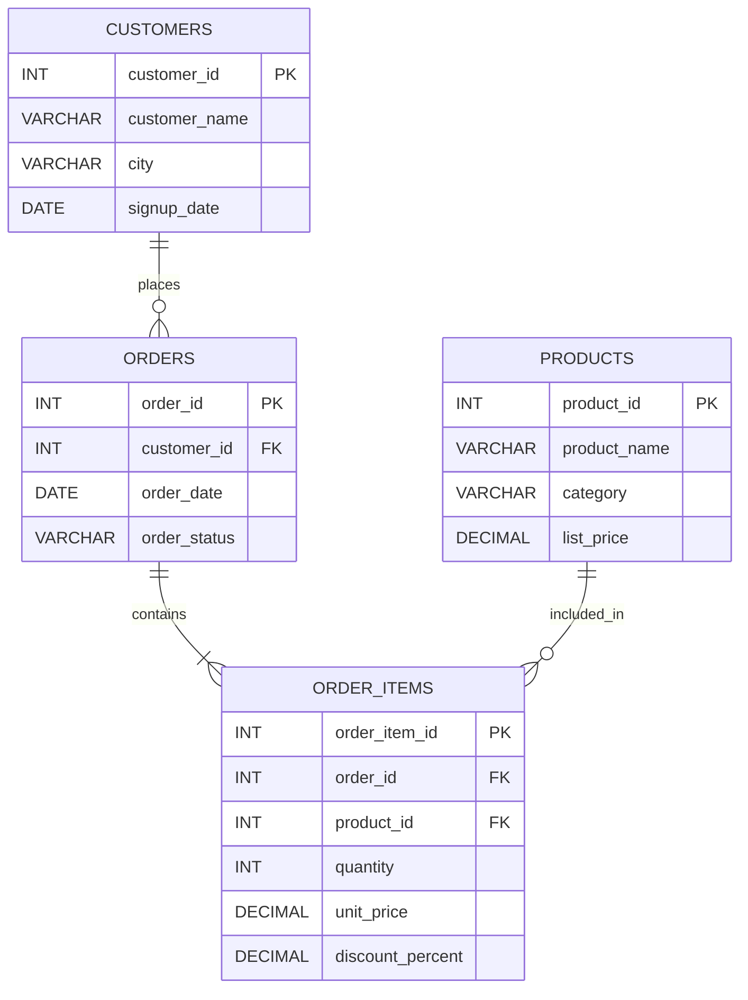

# 🧩 E-Commerce Database ER Diagram

This document shows the relational structure used in the **E-Commerce Customer Analytics & Retention Intelligence** project.

---

## 📊 Entity Relationship Diagram



---

## 🔗 Relationships

### Customers → Orders

One customer can place multiple orders.

```text
CUSTOMERS 1 ───────< MANY ORDERS
```

The relationship is created using:

```text
orders.customer_id → customers.customer_id
```

---

### Orders → Order Items

One order can contain multiple products.

```text
ORDERS 1 ───────< MANY ORDER_ITEMS
```

The relationship is created using:

```text
order_items.order_id → orders.order_id
```

---

### Products → Order Items

One product can appear in many different orders.

```text
PRODUCTS 1 ───────< MANY ORDER_ITEMS
```

The relationship is created using:

```text
order_items.product_id → products.product_id
```

---

## 🧠 Why `order_items` Is Important

The `order_items` table acts as the bridge between orders and products.

Without it, a single order would be limited to one product.

Using `order_items` allows the database to support:

- Multiple products per order
- Different quantities
- Historical product prices
- Item-level discounts
- Product-level revenue analysis

---

## 🔑 Primary Keys

| Table | Primary Key |
|---|---|
| `customers` | `customer_id` |
| `products` | `product_id` |
| `orders` | `order_id` |
| `order_items` | `order_item_id` |

---

## 🔗 Foreign Keys

| Table | Foreign Key | References |
|---|---|---|
| `orders` | `customer_id` | `customers.customer_id` |
| `order_items` | `order_id` | `orders.order_id` |
| `order_items` | `product_id` | `products.product_id` |

---

## 💰 Analytical Flow

```text
Customer
   ↓
Order
   ↓
Order Items
   ↓
Products
   ↓
Revenue Calculation
   ↓
Customer & Product Analytics
```

This relational structure enables revenue analysis, customer lifetime value, product performance, cohort retention, and RFM customer segmentation.